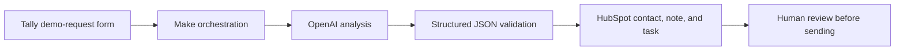
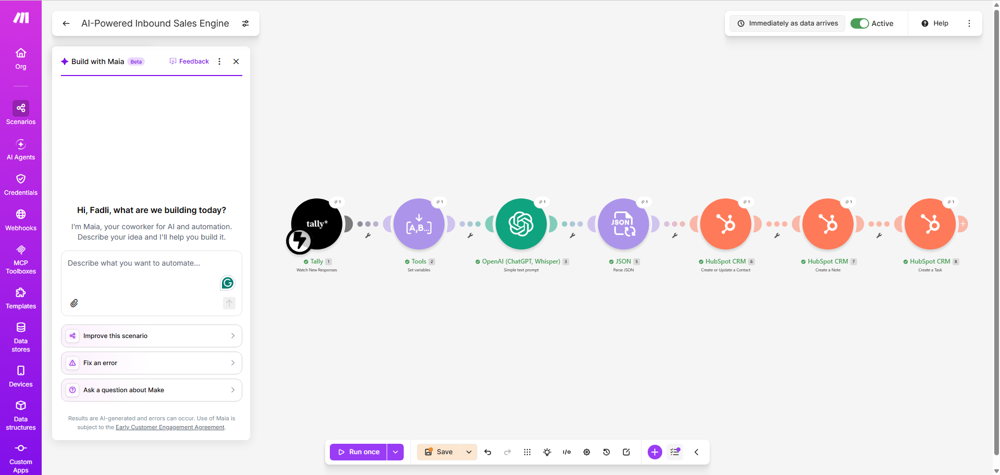
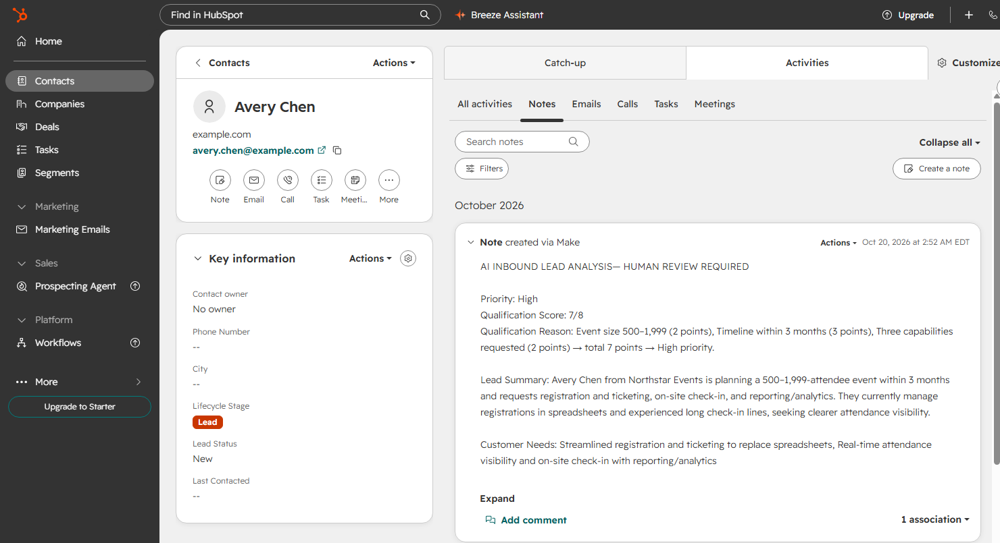
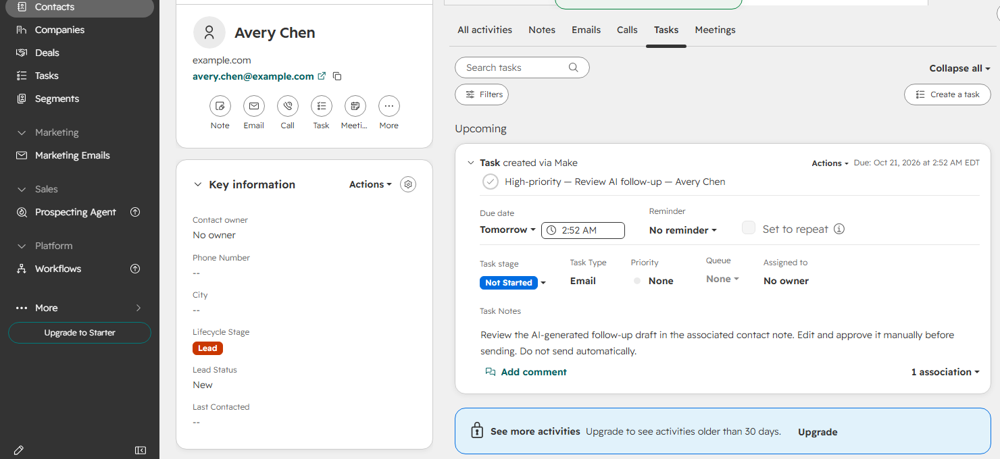
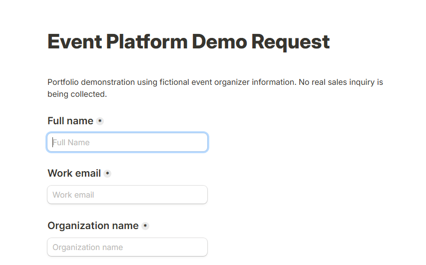
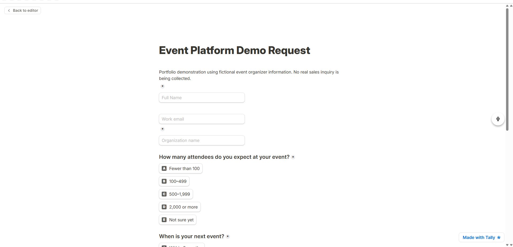
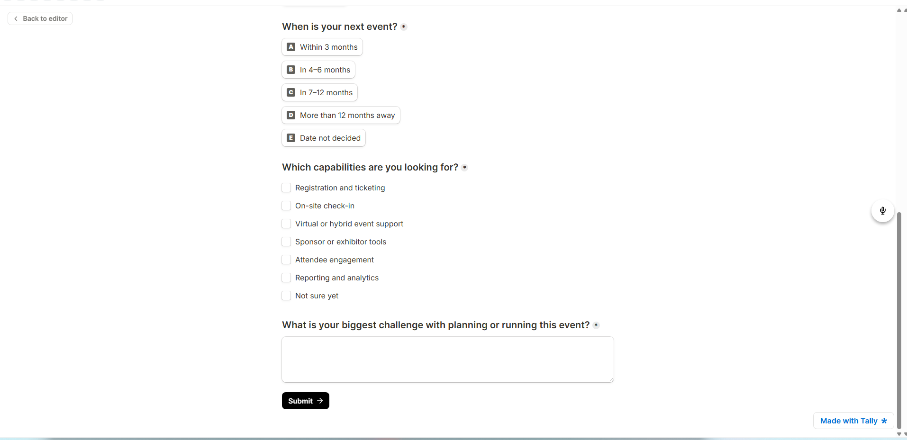

# AI-Powered Inbound Sales Engine


I designed and built an AI-assisted inbound sales workflow that turns a fictional event-platform demo request into an organized, prioritized HubSpot record with sales-ready discovery preparation and a human-approved follow-up draft.

The prototype demonstrates how an inbound sales or revenue operations team can reduce repetitive lead-processing work while preserving transparent qualification logic and human control over customer communication.

> **Independent portfolio prototype:** This project uses fictional organizations and contacts. It is not affiliated with, endorsed by, or deployed at PheedLoop or any other employer.

## What I Built

When a prospect submits the Tally form, the workflow:

1. Captures the lead and submission timestamp.
2. Applies a transparent 8-point qualification model.
3. Classifies the request as High, Medium, or Low priority.
4. Uses OpenAI to prepare a structured lead summary, customer needs, discovery questions, qualification reasoning, and a personalized follow-up draft.
5. Creates or updates the contact in HubSpot.
6. Stores the analysis in a formatted CRM note.
7. Creates a next-day email task requiring manual review and approval.
8. Never sends an outbound message automatically.

## Workflow Architecture



| Component | Purpose |
|---|---|
| Tally | Captures the fictional prospect's event size, timeline, requirements, and business challenge |
| Make | Orchestrates data capture, timestamps, AI processing, JSON parsing, and CRM actions |
| OpenAI API | Produces structured sales preparation based on predefined qualification rules |
| HubSpot Free CRM | Creates or updates the contact, stores the analysis, and schedules the review task |

## Working Automation

The active Make scenario connects eight modules from intake through CRM action.



## Primary Demonstration: Avery Chen

**Avery Chen — Northstar Events (fictional)**

| Input | Value |
|---|---|
| Expected attendance | 500–1,999 |
| Event timeline | Within 3 months |
| Requested capabilities | Registration and ticketing, on-site check-in, reporting and analytics |
| Stated challenge | Spreadsheet-based registration, long check-in lines, and limited attendance visibility |
| Qualification result | **High priority — 7/8** |

The workflow converted Avery's form response into an actionable CRM note containing the score, transparent reasoning, lead summary, customer needs, discovery questions, and a personalized follow-up draft.



It also created a next-day email task that explicitly requires a salesperson to review, edit, and approve the draft before sending.



## Transparent Qualification Model

I defined an 8-point model using information supplied by the prospect. The scoring system is intentionally understandable and auditable; it is a prototype prioritization model, not a prediction of conversion probability.

### Event size — up to 3 points

| Attendees | Points |
|---|---:|
| 2,000+ | 3 |
| 500–1,999 | 2 |
| 100–499 | 1 |
| Under 100 or not sure | 0 |

### Timeline — up to 3 points

| Next event | Points |
|---|---:|
| Within 3 months | 3 |
| 4–6 months | 2 |
| 7–12 months | 1 |
| More than 12 months or date undecided | 0 |

### Requirements — up to 2 points

| Selected capabilities | Points |
|---|---:|
| Three or more defined capabilities | 2 |
| One or two defined capabilities | 1 |
| Only “Not sure yet” | 0 |

### Priority thresholds

| Total | Priority |
|---:|---|
| 6–8 | High |
| 3–5 | Medium |
| 0–2 | Low |

See [Qualification Model](docs/qualification-model.md) for the full logic and rationale.

## Testing and Validation

I tested all three priority outcomes with fictional leads instead of demonstrating only a single ideal path.

| Test lead | Scenario | Breakdown | Result | CRM outcome |
|---|---|---:|---|---|
| Avery Chen — Northstar Events | 500–1,999 attendees, within 3 months, three capabilities | 2 + 3 + 2 | **High — 7/8** | Contact updated; formatted note and review task created |
| Jordan Lee — BrightPath Events | 100–499 attendees, 4–6 months, two capabilities | 1 + 2 + 1 | **Medium — 4/8** | Contact created; note and review task created |
| Casey Morgan — Summit Community Meetup | Under 100, date undecided, requirements undefined | 0 + 0 + 0 | **Low — 0/8** | Contact created; note and review task created |

### Measured processing performance

- Jordan's form was submitted at **1:58:35 a.m. EDT** and the HubSpot activity appeared at **1:58 a.m. EDT**.
- Casey's form was submitted at **2:10:56 a.m. EDT** and the HubSpot contact and activity appeared at **2:11 a.m. EDT**.
- These tests verify **same-minute or next-displayed-minute processing** in the prototype environment. HubSpot's displayed activity time is minute-granular, so I do not claim an exact number of seconds.

See [Testing and Validation](docs/testing-validation.md) for the evidence boundaries and test details.

## Form Design

I designed the intake form to collect only the information needed for initial qualification and discovery preparation. It explicitly states that the demonstration uses fictional data.



<details>
<summary>View form fields</summary>





</details>

## Business Value

This prototype addresses common inbound-sales operational problems:

- **Slow manual triage:** Every request receives a consistent priority and documented rationale.
- **Incomplete discovery preparation:** The CRM record includes needs and tailored questions before a salesperson responds.
- **Scattered context:** Form data, AI analysis, and the next action are organized around the HubSpot contact.
- **Inconsistent follow-up:** A personalized draft and next-day task are prepared automatically.
- **Automation risk:** Outbound communication remains human-approved.
- **Weak process evidence:** Submission and CRM timestamps support measured performance claims.

The same pattern can support inbound SDR teams, sales operations, revenue operations, customer success intake, and solution-consulting discovery workflows.

## Problems I Resolved

During implementation, I diagnosed and resolved several practical integration issues:

- Configured the required HubSpot activity timestamp after the Notes API rejected a note without `hs_timestamp`.
- Corrected HubSpot contact associations so notes and tasks attached to the intended CRM record.
- Structured the model output as JSON and mapped validated fields into downstream modules.
- Reinforced score consistency after identifying a mismatch between a total score and its component breakdown during testing.
- Replaced raw newline characters with HubSpot-compatible HTML formatting so CRM notes remained readable.
- Corrected dynamic task-title concatenation to produce titles such as `High-priority — Review AI follow-up — Avery Chen`.
- Used fictional test records and avoided publishing credentials, tokens, webhook URLs, or private exports.

## Demonstration Flow

1. Open the fictional Tally demo-request form.
2. Submit the Avery Chen / Northstar Events scenario.
3. Show the active Make scenario receiving and processing the request.
4. Open Avery's HubSpot contact.
5. Review the High-priority score, reasoning, summary, needs, and discovery questions.
6. Show the personalized draft marked for human review.
7. Open the next-day task and confirm that no message was sent automatically.
8. Briefly show the Medium and Low test results to demonstrate classification coverage.

See the [Live Demo Guide](docs/demo-guide.md) for a concise 60–90 second walkthrough.

## Security and Privacy

- All published contacts and organizations are fictional.
- No API keys, OAuth tokens, webhook URLs, credentials, or private automation exports are included.
- Screenshots were reviewed and selected to avoid exposing connected-account secrets.
- Outbound messages require human review and approval.
- This repository documents the design and verified results without publishing deployable credentials or proprietary employer data.

## Repository Contents

```text
.
├── README.md
├── SECURITY.md
├── assets/
│   └── screenshots/
│       ├── 01-tally-form-overview.png
│       ├── 02-tally-form-fields.png
│       ├── 03-tally-form-requirements.png
│       ├── 04-make-scenario-active.png
│       ├── 05-hubspot-high-priority-note.png
│       └── 06-hubspot-human-review-task.png
└── docs/
    ├── demo-guide.md
    ├── implementation-notes.md
    ├── qualification-model.md
    └── testing-validation.md
```

## Scope

This is a working minimum viable prototype. It demonstrates intake, qualification, AI-assisted sales preparation, CRM organization, task creation, human approval controls, and measured workflow timing. It does not claim production deployment, conversion improvement, revenue impact, or affiliation with PheedLoop.

